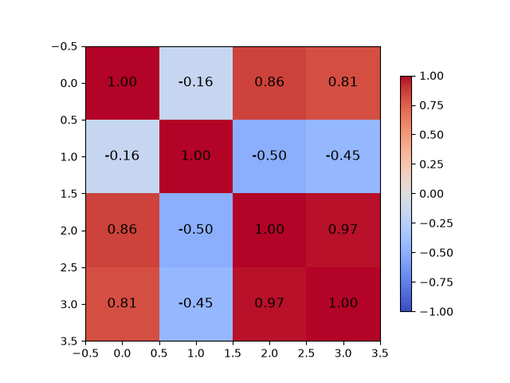
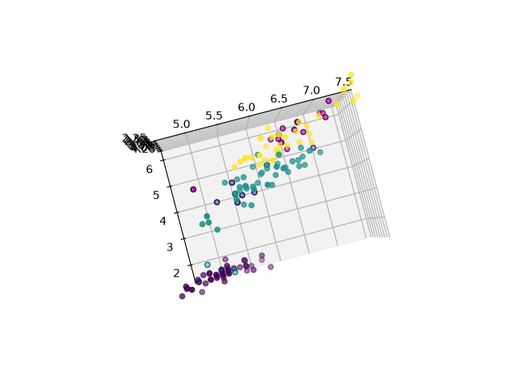

# KNN на Iris: собственная реализация и сравнение с scikit-learn


## Описание

Проект содержит собственную реализацию алгоритма k-ближайших соседей (KNN) на NumPy и сравнение с эталонной реализацией из scikit-learn на датасете Iris.

В обоих случаях на выбранном разбиении достигнута точность 1.0. Результаты собственной модели и scikit-learn совпали.

## Структура проекта

- `knn_torch.ipynb` — ноутбук с использованием `KNeighborsClassifier` из scikit-learn, `StandardScaler` и `train_test_split`.
- `load_dataset.py` — загрузка Iris, перемешивание, разбиение на train/validation, стандартизация, визуализация и корреляционный анализ.
- `my_knn.py` — собственная реализация KNN: класс `KNN` с методами `fit`, `predict`, `visual_dots`.
- `predict_model.py` — запуск собственной модели, вывод точности и 3D-визуализация.
- `README.md` — описание проекта.
- `anse.png` — изображение с результатом/визуализацией.
- `corrcoef.png` — матрица корреляций признаков.
- `data_analiz.png` — визуализация распределения признаков.
- `Figure_1.png` — 2D-график knn на синтетических данный для проверки.

## Требования

- Python 3.12.3
- NumPy
- Matplotlib
- scikit-learn
- Jupyter Notebook — для запуска `knn_torch.ipynb`

Установка зависимостей:

```bash
pip install numpy matplotlib scikit-learn jupyter
```

## Запуск

### Собственная реализация KNN

```bash
python predict_model.py
```

Ожидаемый вывод:

```text
start
knn cteate
data loaded
training model end
accuratly: 1.0000
```

### Ноутбук со scikit-learn

```bash
jupyter notebook knn_torch.ipynb
```

Ожидаемый результат:

```text
accuracy score: 1.0
```

## Данные и предобработка

- Используется датасет Iris: 150 объектов, 4 признака, 3 класса.
- В `load_dataset.py`:
  - фиксируется `np.random.seed(4)`;
  - данные случайно перемешиваются;
  - 120 объектов идут на обучение;
  - 30 объектов идут на валидацию;
  - выполняется стандартизация по формуле `(x - mean) / std`;
  - `mean` и `std` вычисляются на обучающей выборке и применяются к валидационной.
- В `knn_torch.ipynb`:
  - используется `train_test_split(test_size=0.2, random_state=42)`;
  - применяется `StandardScaler`.

Название `knn_torch.ipynb` историческое: внутри используется scikit-learn, а не PyTorch.

## Реализация KNN

Класс `KNN` находится в `my_knn.py`.

Основные методы:

- `__init__(self, k=1)` — задает число соседей.
- `fit(self, x, y)` — сохраняет обучающую выборку.
- `predict(self, x)` — вычисляет евклидовы расстояния и возвращает предсказанные классы.
- `visual_dots(self, x_v, y_v)` — строит 3D-визуализацию первых трех признаков обучающей и валидационной выборок.

Евклидово расстояние вычисляется через разложение:

$$
d^2(x, x_{\text{train}}) = \|x\|^2 - 2\,(x \cdot x_{\text{train}}) + \|x_{\text{train}}\|^2
$$

Далее выбираются `k` ближайших соседей, и класс определяется большинством голосов.

## Результаты

| Реализация | Метод | Точность |
| --- | --- | --- |
| scikit-learn | `KNeighborsClassifier(n_neighbors=1)` | 1.0 |
| Собственная | `KNN(k=1)` | 1.0000 |

Результаты совпали. На выбранном разбиении Iris обе модели не допускают ошибок.

## Матрица корреляций

<p align="center">
  
</p>

Матрица корреляций показывает, что признаки `petal length` и `petal width` сильно коррелируют между собой (коэффициент около 0.96). Формально это означает мультиколлинеарность, и по-хорошему один из этих двух признаков, а также менее информативные `sepal length` и `sepal width`, можно было бы удалить — оставив, например, только `petal length` и `petal width` или даже один признак.

Однако на практике при удалении признаков точность падает. Причина — размер датасета. В Iris всего 150 объектов, и обучающая выборка содержит лишь 120 точек. При таком объёме данных каждый признак, даже слабоинформативный и коррелирующий с другим, добавляет разделяющую способность. Удаление признаков сужает пространство и может привести к тому, что близкие в исходном пространстве точки разных классов окажутся ещё ближе друг к другу после отбрасывания размерности, что снижает точность KNN.

Поэтому все 4 признака сохранены.

## 3D-визуализация выборок

<p align="center">
  
</p>

На графике показаны первые три признака после стандартизации. Точками без обводки отмечена обучающая выборка, точками с чёрной обводкой — валидационная. Цвет соответствует истинному классу.

Из графика видно, что:

- класс `setosa` отделяется от остальных линейно и находится в своей области пространства;
- классы `versicolor` и `virginica` частично пересекаются, но всё равно образуют достаточно плотные кластеры;
- при `k=1` каждый валидационный объект попадает в кластер своего класса, поэтому точность равна 1.0.

Именно потому что кластеры плотные и хорошо разделены, KNN с `k=1` показывает максимальную точность на этом разбиении.

## Итоги

- Собственная реализация KNN на NumPy показала точность 1.0000 на валидационной выборке Iris.
- Эталонная реализация `KNeighborsClassifier` из scikit-learn показала точность 1.0 на той же задаче.
- Результаты полностью совпали, что подтверждает корректность собственной реализации.
- Векторизованное вычисление расстояний через матричное умножение работает быстро и не требует двойного цикла.
- Признаки `petal length` и `petal width` сильно коррелируют, но удалять их не стоит из-за малого размера датасета — потеря признаков снижает точность.
- Датасет Iris хорошо разделим при `k=1`: классы `setosa`, `versicolor` и `virginica` образуют плотные кластеры в пространстве признаков.
